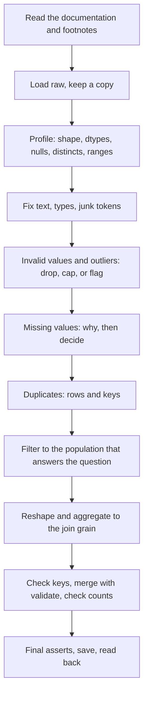

# Data cleaning and merging: workflow, checklist, and pitfalls

> **Source:** CS-540 Modules 1 to 3 and the Module 9 project, plus the zyBook chapters on data quality, wrangling, and joins.
>
> **Saved via:** End-of-course notes.

## The idea

Cleaning is deciding, for every problem, whether to fix it, flag it, or leave it alone, and writing down why. Merging is where quiet mistakes multiply, so every join gets checked before, during, and after. Code for each step is in [Python patterns](./python-patterns.mdx).

## Workflow

## Checklist

### Before touching anything

- [ ] What question is this data supposed to answer? What decision hangs on it?
- [ ] Who made the data, how, and how often is it updated? Is it provisional or self-reported?
- [ ] Read the data dictionary and footnotes. Look for suppression rules, codes for "not reported," and units.
- [ ] What is one row (the grain)? Are there total or subtotal rows mixed in?

### Profile

- [ ] `shape`, `head()`, `info()`, `describe()`
- [ ] Null count and null share per column
- [ ] `value_counts(dropna=False)` on every categorical column
- [ ] `nunique()` on anything that should be an ID
- [ ] Min and max of every numeric column. Are they physically possible?

### Clean

- [ ] Strip whitespace, normalize case, collapse repeated spaces
- [ ] Turn blanks and junk tokens into real missing values
- [ ] Convert types on purpose: `to_numeric(errors="coerce")`, `to_datetime(format=...)`, `category`
- [ ] Invalid values to `NaN` (negative rain, age 250, low temp above high temp)
- [ ] Outliers: look at `nlargest`, then decide to cap, flag, or drop, and count the rows affected
- [ ] Missing values: fill only with a defensible value, use an explicit `"Unknown"` for categories
- [ ] Exact duplicate rows and duplicate keys

### Merge

- [ ] Both keys have the same dtype and the same format (case, prefix, padding)
- [ ] Count keys that are only on one side before joining
- [ ] The lookup side is unique on the key
- [ ] Pick the join type on purpose (left to keep every fact row, inner for matched only)
- [ ] `validate="many_to_one"` or `"1:1"`, and `indicator=True`
- [ ] Row count before vs. after. A many-to-one left join should not add rows
- [ ] Nulls in the joined columns after the merge

### Finish

- [ ] Asserts for keys, ranges, uniqueness, and expected row counts
- [ ] Save with `index=False`, read it back, compare shapes
- [ ] Write down every cleaning decision and how many rows it touched

## Pitfalls I hit

| Pitfall | What happened | Fix |
| --- | --- | --- |
| Deliberate gaps look like dirty data | CDC/NCHS COVID deaths: about 29% of death counts blank. The footnote said counts of 1 to 9 are suppressed for privacy | Treat as suppressed, not random. Say so in any result |
| Mixed grain in one table | Same COVID file had By Total, By Year, and By Month rows. A plain sum overcounts about 3x, no error | Filter to one grain before summing |
| Aggregate columns next to detail | OWID file had World, continents, and income groups next to 234 countries | Drop aggregates before summing countries |
| Numbers stored as text | NTD money columns like `"$1,493,280.00 "`; College Scorecard `"PS"` markers | Strip symbols with regex, replace markers with `NaN`, then `to_numeric` |
| "Not measured" filled as zero | Weather stations that never measure wind would look calm | Leave `NaN`. Only fill 0 where the source says blank means no event |
| Keys that almost match | Station IDs had a `GHCND:` prefix on one side | Same cleanup function on both sides, check sample keys |
| Pivot or merge on duplicate keys | Pivot raises, and merge silently copies rows | `drop_duplicates(subset=keys)` before, `validate=` during |
| Correlating running totals | Every pair of cumulative series came out at 0.91 or higher | Correlate weekly changes (`diff`) instead |
| Raw totals across different sizes | Total transit trips mostly measured population | Use per resident, per trip, per 1,000 tons |
| First N rows of a sorted file | Scorecard is sorted by state, so the first 1,000 rows were two states | `sample(n, random_state=42)` |
| Stale self-reported records | Half of all MCS-150 filings were over 24 months old (14% after filtering) | Flag staleness and report it as a limit |

## The 9-1 walkthrough: FMCSA and FAF

The project question: where is vehicle-hauling carrier capacity thin compared to the vehicle freight that needs to move, and what are costs doing? Five public sources, joined at the state level and the month level. Sources are described in [Datasets and sources](./datasets-and-sources.mdx).

### 1. Profile each source

- FMCSA Company Census File, filtered at download to active carriers with the Motor Vehicles cargo flag: 212,942 carriers. Read with `dtype=str`. Names, phones, and emails dropped.
- FAF 5.7.1 state origin-destination rows for SCTG 36 (motorized vehicles), all modes, 2018 to 2024: 46,017 rows. Trucks carry 85.3% of 2024 vehicle tons.
- Census state population, FRED weekly diesel, FRED monthly truckload PPI.

### 2. Find the quality problems

| Problem | Count | Decision |
| --- | --- | --- |
| Impossible fleet size (max 858,001 power units) | 70 carriers above the 99.9th percentile (830) | Cap at 830 with `clip` |
| Mileage over 300,000 per truck per year | 2,198 carriers (max 2,145,160,200 miles) | Set mileage to `NaN`, keep the carrier |
| Zero power units | 13,653 | Filter out (no truck, no capacity) |
| Non-U.S. state codes (ON, QC, PR, ...) | 2,027 in 33 codes | Filter to the 50 states plus DC |
| MCS-150 older than 24 months | 49.6% of all rows, 14.0% after filtering | Flag and report as a limit |
| Motor Vehicles flag is broad | 57.3% also flag general freight | Keep a stricter "vehicle-only" subset (14,846) |
| In-state FAF flows | 55.2% of truck vehicle tons | Count them once (see step 4) |

### 3. Filter to the population that matters

For-hire, interstate, U.S.-based, at least one truck: 212,942 down to 69,426 carriers.

### 4. Aggregate each side to the join grain (state)

- Carriers: `groupby("phy_state").agg(...)` for carrier count, capped truck sum, share with one truck, share stale.
- FAF: outbound tons by origin state, inbound by destination state, in-state tons where origin equals destination. Freight touching a state = outbound + inbound - in-state. Without the subtraction, in-state tons count twice.
- Census: state rows only (`SUMLEV == 40`), drop Puerto Rico because FAF doesn't cover it.

### 5. Build the key crosswalk and merge

FAF and Census use numeric FIPS codes. FMCSA uses postal codes. A FIPS-to-postal dictionary bridges them. Then two `validate="1:1"` inner joins and `assert len(merged) == 51`. Zero missing values after the join.

### 6. Derive comparable measures

- Carrier trucks per 1,000 kt (thousand tons) of freight
- Carriers per 100,000 residents
- Percent change in outbound tons, 2018 to 2024

### 7. Join the monthly cost series

Diesel is weekly, PPI is monthly. Resample diesel to monthly means, inner-join on the date, keep 2018 onward, and index both to January 2020 = 100.

### What came out of it

- Five states (MI, IN, CA, TX, KY) ship 47.6% of outbound truck vehicle tons.
- Carrier counts track population (r = 0.84) more than freight (r = 0.57).
- Nationally there are 1,710 carrier trucks per 1,000 kt. Among the top 20 freight states, the bottom quarter were KY (373), MI (509), AR (682), AL (960), and SC (987).
- 52.2% of the 69,426 carriers run one truck, and 84.2% run five or fewer.
- Since January 2020, the truckload PPI is up 69% and monthly diesel is up 105% (r = 0.88 since 2018).
- Equipment setups, from owned plus leased counts: tractor plus trailer 41.2%, trucks only 20.0%, truck plus trailer with no tractor 18.2%. Among vehicle-only carriers, trucks only rises to 40.9%.

### Limits I had to state

- FMCSA counts sit at the carrier's base state, not where its trucks run.
- MCS-150 counts are self-reported and some are stale.
- FAF tons are modeled estimates and include parts, not just finished vehicles.
- Nothing in the census says whether a trailer is open or enclosed or how many cars it holds.
- Correlation between carriers and population doesn't say why carriers locate where they do.

## Key takeaways

- Read the footnotes first. Half of "dirty data" is documented on purpose.
- Decide fix, flag, or leave for each problem, and count the rows each decision touched.
- Aggregate both sides to the same grain before joining.
- `validate=`, `indicator=True`, and a row-count assert on every merge.
- A derived ratio (per 1,000 kt, per resident) is usually the number the story needs.
