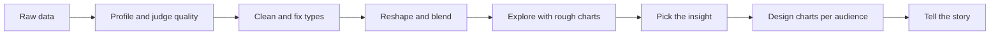

# CS-540 Data Literacy & Visualization: course recap

> **Source:** My SNHU CS-540 coursework (master's in CS), Sep to Nov 2026: the course zyBook, the weekly Codio notebooks, and my own papers.
>
> **Saved via:** End-of-course notes, so I can relearn this stuff later without redoing the class.

## The idea

CS-540 is about going from a raw file to a decision someone can act on. The course runs in that order: judge the data, clean it, blend it with other data, chart it, then tell a story with it for a specific audience. Python (pandas, Matplotlib, seaborn, Plotly) does the work, and the writing explains it.

## How to use these notes

| Page | Open it when |
| --- | --- |
| [Glossary](./glossary.mdx) | A term shows up and I can't remember exactly what it means |
| [Python patterns](./python-patterns.mdx) | I need the code for load, clean, merge, group, or plot |
| [Data cleaning and merging](./data-cleaning-and-merging.mdx) | I'm starting a new data set and want the checklist and the traps |
| [Visualization principles](./visualization-principles.mdx) | I'm picking a chart, designing it for an audience, or writing the story |
| [Datasets and sources](./datasets-and-sources.mdx) | I need a public data source again, or want to remember what one measures |

Quick refresher path: read the module recap below, skim the glossary, then read the 9-1 walkthrough in [Data cleaning and merging](./data-cleaning-and-merging.mdx). That one project uses almost everything from the course.

## The workflow in one picture

## Module-by-module recap

### Module 1: Data quality and evaluating a data set

Data is an asset only when it's fit for its intended use. I evaluated the CDC/NCHS Provisional COVID-19 Deaths by Sex and Age file: 137,700 rows, 16 columns. The two lessons were that missing values can be on purpose (NCHS suppresses counts of 1 to 9 for privacy) and that one table can hold several levels of the same data (By Total, By Year, By Month), so a plain sum overcounts about three times and throws no error.

- Read the footnotes and documentation before calling a gap "dirty data."
- Check whether rows are at one grain before you add anything up.
- Dates stored as text and integer counts stored as floats are normal on load. Fix them before math.

### Module 2: Clean It, Code It, Frame It

Turn a messy file into a validated table. The activity file was a dirty business data set (customer ID, gender, age, income, spending score, membership, product type).

- Work on a copy (`raw.copy()`) so the original stays for comparison.
- Strip whitespace, normalize case, turn junk tokens and blanks into real missing values.
- Invalidate impossible values (age outside 18 to 100) instead of guessing.
- Fill categorical gaps with an explicit `"Unknown"` level, set dtypes (int, float, category), then validate: null counts, ranges, unique IDs, no duplicate rows.

### Module 3: From Raw to Ready (preprocessing and blending)

Blend more than one data set into a model-ready table. I joined NOAA daily weather readings (long format) to a weather station lookup table.

- Make join keys match exactly on both sides: same dtype, trimmed, same case, same prefix.
- Pivot long data to wide (one row per station per day) before joining to a one-row-per-key table.
- Use `validate="many_to_one"` and `indicator=True` on the merge, then check row counts did not change.
- "Not measured" is not zero. Only fill with 0 when the source's rules say a blank means "didn't happen."

### Module 4: Comparing visualizations for impact

Three charts of the same state higher-education funding table (NCES Digest): a multi-line trend, a bar chart with a mean line, and a two-panel percent-change plus box plot. The job was to judge each on chart type, layout, labeling, clarity, and fit with the data type, then pick one for non-expert policymakers and suggest fixes. The discussion that week covered balancing complexity with clarity in healthcare policy charts.

- Match chart type to data type: time goes on a line, categories on bars, distributions on box plots.
- A chart that's "technically complete" can still be the wrong pick for a non-expert audience.
- Refinements should be justified by what the audience needs, not by what looks nice.

### Module 5: Visualize the Insight (exploring patterns with Python)

Find structure in a big file. I used the College Scorecard field-of-study file (229,188 program rows) and grouped programs by graduates, debt, and earnings.

- Privacy-suppressed markers (`"PS"`) make numeric columns load as text. Replace them with `NaN` first.
- Log-transform heavily skewed counts (`np.log1p`) before scaling, or a few giants flatten everything.
- Min-max scale, take a fixed random sample (`random_state=42`) instead of the first N rows of a sorted file.
- Hierarchical clustering (Ward), a dendrogram, PCA to 2D for a scatter, and a heatmap of cluster means.

### Module 6: Advanced and dynamic visualization

Design choices, interactivity, animation, and accessibility. I built a COVID-19 deaths dashboard from Our World in Data (WHO reports).

- Drop aggregate rows/columns (World, continents, income groups) before summing countries.
- Correlate changes (weekly new deaths), not running totals. Cumulative series all trend up, so they all look highly correlated.
- Overview first, detail on demand: drill-down dropdowns, a range slider, an overview plus detail layout.
- One colorblind-safe palette across static and interactive charts. Avoid red-green. Use a log scale when values span orders of magnitude.

### Module 7: Exploratory vs. explanatory analysis

Exploratory analysis is for me, to find out what's in the data. Explanatory analysis is for an audience, to get them to understand one thing and act. The activity compared transit use in three areas using the FTA National Transit Database.

- My first chart (total trips) mostly measured population. Per-resident and per-trip rates told the real story.
- Normalize before comparing places of different sizes.
- Explore with many rough charts, explain with one or two designed ones.

### Module 8: Introduction to data storytelling

Data rarely speaks for itself. Structure the story for the audience: executives, technical experts, or the public.

- Story structure: beginning, middle, end. The Pixar-style story spine is a fast way to outline it.
- Tailor the level of detail, the framing, and the call to action to each audience.
- Every "because of that" in a story claims a cause. Only keep the ones the data backs up.

### Module 9: From Data to Decisions (final project)

The capstone: EDA, quality checks, preprocessing, blending five public data sets, overview and detail visuals, and a 4 to 6 page narrative for two stakeholder groups. My topic was where vehicle-hauling carrier capacity is thin compared to vehicle freight, using FMCSA, FAF, Census, and FRED data. Full walkthrough in [Data cleaning and merging](./data-cleaning-and-merging.mdx#the-9-1-walkthrough-fmcsa-and-faf).

- Filter to the population that matters for the question, then cap outliers at a percentile.
- Join on a shared geographic key (FIPS to postal code), validate 1:1, assert the final row count.
- Weekly series get averaged to monthly before joining to monthly series.
- Split the charts by audience: overview charts for leadership, detail charts for the team that acts.

### Module 10: Reflection and portfolio

A journal looking back on the course (hardest part, one data literacy skill to keep, how the visuals carried the story, how my view of data changed) and a GitHub portfolio of the course work.

- The skill I'm keeping: check what a table actually measures before using it to size anything.

## Key takeaways

- Judge fitness for use before analysis. Read the documentation, footnotes, and suppression rules.
- Missing is not zero, and not measured is not calm.
- Validate every merge: key uniqueness, row counts, match counts.
- Normalize (per capita, per trip, per 1,000 tons) before comparing groups of different sizes.
- Correlation is not causation, and cumulative series inflate correlation.
- Exploration is for me. Explanation is for them. Design the explanatory chart around one claim and one audience.
